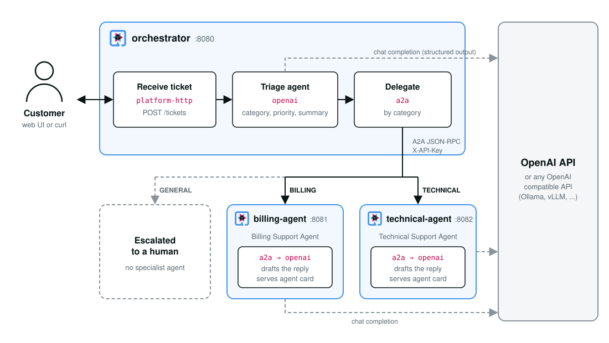

= A2A Support Ticket Triage with OpenAI: A Camel Quarkus example
:cq-example-description: An example that shows how to build an AI agent that triages customer support tickets with OpenAI and delegates them to specialist agents using the Agent-to-Agent (A2A) protocol

{cq-description}

TIP: Check the https://camel.apache.org/camel-quarkus/latest/first-steps.html[Camel Quarkus User guide] for prerequisites
and other general information.

== What the example does

A customer support desk receives tickets through an HTTP API. Instead of a human reading every ticket first, a
*triage agent* classifies each ticket with a large language model and hands it over to the *specialist agent* for
that category, which drafts the reply a support engineer will send. Tickets that no specialist handles are escalated
to a human.

The agents talk to each other using the https://a2a-protocol.org[Agent-to-Agent (A2A) protocol], an open standard
for communication between AI agents. Each agent publishes an _agent card_ that describes what it can do and how it
must be called, so agents built with different frameworks, by different teams, can discover and use each other.

The three Camel Quarkus extensions involved are:

* `camel-quarkus-platform-http` serves the `POST /tickets` endpoint and the HTTP endpoints of the A2A agents on the
  Quarkus HTTP server.
* `camel-quarkus-openai` calls OpenAI, or any OpenAI compatible API, for the triage decision and the drafted replies.
* `camel-quarkus-a2a` exposes Camel routes as A2A agents (consumer) and calls A2A agents (producer). It serves the
  agent cards, implements the protocol, manages task state and enforces authentication, so that the routes only
  contain business logic.

The example is made of three independent applications, each in its own Maven module, plus a test module:

* `orchestrator` receives the tickets. `TicketTriageRoutes` validates the ticket, asks the triage agent for a
  category, a priority and a summary, and delegates the ticket to the specialist agent for the category. The triage
  agent uses the https://platform.openai.com/docs/guides/structured-outputs[structured outputs] feature of OpenAI: a
  strict JSON schema is derived from the `TicketTriage` class, so the model can only answer with the categories and
  priorities declared there. `TriageSupport` holds the plain Java steps: input validation, prompt building,
  validation of the model output and assembling the response.
* `billing-agent` and `technical-agent` are the specialist agents. Each one is a tiny application with a single
  Camel route consuming from an `a2a` endpoint and drafting the reply with OpenAI, its agent card in
  `src/main/resources/cards` and its system prompt in `src/main/resources/prompts`. They know nothing about the
  orchestrator and can be called by any A2A compliant client.
* `integration-tests` assembles the three applications into one and tests the whole flow, see <<testing>>.

The orchestrator only knows the agents by their URLs (`a2a.agents.billing.url` and `a2a.agents.technical.url` in
its `application.properties`). It fetches their agent cards to learn how to talk to them, in particular the
security scheme, and sends the ticket as an A2A message. The agents advertise the URL under which they are reachable
(`a2a.billing-agent.public-url` and `a2a.technical-agent.public-url`) in their cards, so that other A2A clients can
find them too.

== Prerequisites

The example needs an https://platform.openai.com/[OpenAI] API key, or access to any OpenAI compatible API such as
Azure OpenAI, vLLM or Ollama. No OpenAI account? See <<local-model>> to run the example against a model on your
own machine. The configuration is read from environment variables:

[cols="1,3"]
|===
| Variable | Description

| `OPENAI_API_KEY`
| The API key. It is read by the `openai` component itself and is never written to `application.properties`.
  It must not be empty, even for local servers that ignore it.

| `OPENAI_BASE_URL`
| The base URL of the API. Defaults to `https://api.openai.com/v1`.

| `OPENAI_MODEL`
| The chat model. Defaults to `gpt-5-mini`.
|===

[[local-model]]
=== Using a local model instead of OpenAI

The applications only talk to the OpenAI _API_, so any server that implements it can stand in for OpenAI. With
https://ollama.com[Ollama], for example, everything runs on your machine, with no account and no cost. The model
must support structured outputs (JSON schema), which the triage agent relies on. `llama3.2:3b` is small enough
to run on a laptop CPU and works with this example.

Install Ollama and pull the model:

[source,shell]
----
ollama pull llama3.2:3b
----

Or run Ollama in a container instead (`podman` works the same way):

[source,shell]
----
docker run -d --name ollama -p 11434:11434 -v ollama:/root/.ollama ollama/ollama
docker exec ollama ollama pull llama3.2:3b
----

Then point the applications at Ollama before starting them in dev mode, in JVM mode or in native mode, as described below:

[source,shell]
----
export OPENAI_BASE_URL=http://localhost:11434/v1
export OPENAI_MODEL=llama3.2:3b
# Ollama ignores the key, but the OpenAI client refuses to start without one
export OPENAI_API_KEY=ollama
----

Expect slower answers than from OpenAI, around 10 seconds per drafted reply on a laptop CPU, and replies of lower
quality: small models are more likely to promise things the prompt does not allow, such as a refund date.

== Start in Development mode

The three applications run in their own JVMs. Start them from three terminals:

[source,shell]
----
export OPENAI_API_KEY=<your-api-key>

mvn -f billing-agent/pom.xml quarkus:dev     # listens on port 8081
mvn -f technical-agent/pom.xml quarkus:dev   # listens on port 8082
mvn -f orchestrator/pom.xml quarkus:dev      # listens on port 8080
----

Or, on Linux and macOS, use the `run.sh` script, which starts the three applications in the background, writing
their output to `<module>.log` and their process ids to `<module>.pid`. `stop.sh` stops them again:

[source,shell]
----
export OPENAI_API_KEY=<your-api-key>
./run.sh
...
./stop.sh
----

On Windows, use the `run.ps1` and `stop.ps1` PowerShell scripts instead:

[source,powershell]
----
$env:OPENAI_API_KEY = "<your-api-key>"
.\run.ps1
...
.\stop.ps1
----

Each application runs in dev mode: the Quarkus tooling watches for changes in its module and any modification
automatically takes effect in the running application.

TIP: Please refer to the Development mode section of
https://camel.apache.org/camel-quarkus/latest/first-steps.html#_development_mode[Camel Quarkus User guide] for more details.

In dev mode, the specialist agents are protected with the throwaway API key `dev-only-not-a-secret` configured by
the `%dev.a2a.agents.api-key` property of each application. The agents do not have to be running when the
orchestrator starts: it fetches their agent cards when the first ticket of a category arrives.

=== Submit a ticket from the web UI

The orchestrator also serves a small web UI at http://localhost:8080/. It has a form for the ticket and buttons that fill in sample billing,
technical and general tickets. When a ticket is submitted, the UI shows which path it took through the agents, the
triage decision and the drafted reply. The `New ticket` button clears the form and the result to start over. Tickets
submitted during the session are listed at the bottom of the page.

The indicator in the page header shows which LLM the orchestrator is configured with: `OpenAI` and the model name,
or the host of the OpenAI compatible API when `OPENAI_BASE_URL` points elsewhere, for example `localhost:11434` for
Ollama. It is backed by the `GET /llm` endpoint and reflects the orchestrator only, as the specialist agents are
separate applications with their own configuration.

=== Submit a ticket with curl

A billing ticket is delegated to the billing agent, which drafts a reply:

[source,shell]
----
curl -s -X POST http://localhost:8080/tickets \
  -H 'Content-Type: application/json' \
  -d '{
    "subject": "Charged twice for my Pro subscription",
    "body": "Hi, I was billed twice on 3 October for the Pro plan, invoices INV-20931 and INV-20932 are identical. Please refund the duplicate charge."
  }'
----

[source,json]
----
{
  "ticketId": "6f1c9a9e-0d2b-4b0e-9a0c-3a0f6f0b7a11",
  "category": "BILLING",
  "priority": "HIGH",
  "summary": "Customer reports being charged twice for the Pro plan on 3 October and asks for a refund of the duplicate charge.",
  "status": "REPLIED",
  "handledBy": "Billing Support Agent",
  "taskId": "3f0c7a2e-5c4d-4f0a-9d2b-1e8c0b4a7f55",
  "reply": "Hello,\n\nThank you for letting us know, and sorry for the trouble. ... Kind regards,\nAcme Billing Support"
}
----

The application logs show the triage decision and the task processed by the specialist agent. Note that the
ticket content itself is never logged, as it may contain personal data:

[source]
----
# orchestrator
INFO  [ticket-triage] Ticket 6f1c9a9e-0d2b-4b0e-9a0c-3a0f6f0b7a11 received
INFO  [ticket-triage] Ticket 6f1c9a9e-0d2b-4b0e-9a0c-3a0f6f0b7a11 triaged as BILLING with priority HIGH
# billing-agent
INFO  [billing-agent] billing-agent started task 3f0c7a2e-5c4d-4f0a-9d2b-1e8c0b4a7f55
INFO  [billing-agent] billing-agent completed task 3f0c7a2e-5c4d-4f0a-9d2b-1e8c0b4a7f55
----

A technical ticket goes to the technical agent instead:

[source,shell]
----
curl -s -X POST http://localhost:8080/tickets \
  -H 'Content-Type: application/json' \
  -d '{
    "subject": "Mobile app crashes on login",
    "body": "Since this morning the Android app closes immediately after I enter my password. Version 4.2.1 on a Pixel 8, reinstalling did not help."
  }'
----

A ticket that belongs to neither category is classified as `GENERAL`. There is no specialist agent for it, so it is
escalated to a human and no reply is drafted:

[source,shell]
----
curl -s -X POST http://localhost:8080/tickets \
  -H 'Content-Type: application/json' \
  -d '{
    "subject": "Partnership enquiry",
    "body": "We run a consultancy and would like to resell your product to our clients. Who should we talk to about a partnership?"
  }'
----

[source,json]
----
{
  "ticketId": "c2b5d1e7-8a3f-4e6b-b0d9-7f1a2c3d4e5f",
  "category": "GENERAL",
  "priority": "LOW",
  "summary": "A consultancy asks who to contact about reselling the product through a partnership.",
  "status": "ESCALATED"
}
----

Invalid tickets, for example with a missing or oversized body, are rejected with HTTP 400 before any call to the
model is made. When more than `triage.max-concurrent-tickets` tickets are being processed, additional requests are
rejected with HTTP 503 and a `Retry-After` header.

=== Talk to a specialist agent directly

The specialist agents are regular A2A agents, so any A2A client can use them. Discovery starts with the agent card,
which is public:

[source,shell]
----
curl -s http://localhost:8081/agents/billing/.well-known/agent-card.json
----

[source,json]
----
{
  "name": "Billing Support Agent",
  "description": "Drafts replies to customer support tickets about invoices, payments, refunds and subscriptions",
  "version": "1.0.0",
  "capabilities": { "streaming": true, "pushNotifications": false },
  "skills": [ { "id": "draft-billing-reply", ... } ],
  "supportedInterfaces": [ { "url": "http://localhost:8081/agents/billing", "protocolBinding": "JSONRPC", "protocolVersion": "1.0" } ],
  "securitySchemes": { "apiKey": { "apiKeySecurityScheme": { "location": "header", "name": "X-API-Key" } } },
  "securityRequirements": [ { "schemes": { "apiKey": { "list": [] } } } ],
  ...
}
----

The card declares that every operation must be authenticated with an API key sent in the `X-API-Key` header. The
agents use the JSON-RPC binding of the A2A protocol, so all operations are sent as `POST` requests to the agent
base path. Sending a message with the dev mode API key:

[source,shell]
----
curl -s -X POST http://localhost:8081/agents/billing/ \
  -H 'Content-Type: application/json' \
  -H 'X-API-Key: dev-only-not-a-secret' \
  -d '{
    "jsonrpc": "2.0",
    "id": "1",
    "method": "SendMessage",
    "params": {
      "message": {
        "messageId": "msg-1",
        "role": "user",
        "parts": [ { "text": "I was charged twice for my Pro subscription this month, please refund one of the payments." } ]
      }
    }
  }'
----

The response is a completed A2A task whose last message holds the drafted reply:

[source,json]
----
{
  "jsonrpc": "2.0",
  "id": "1",
  "result": {
    "task": {
      "id": "0b1f3c6a-...",
      "contextId": "9d8e7f6a-...",
      "status": {
        "state": "TASK_STATE_COMPLETED",
        "message": { "role": "ROLE_AGENT", "parts": [ { "text": "Hello,\n\nThank you for contacting us, ..." } ], ... },
        ...
      },
      ...
    }
  }
}
----

The task can be fetched again later with the `GetTask` method and the task `id` from the response:

[source,shell]
----
curl -s -X POST http://localhost:8081/agents/billing/ \
  -H 'Content-Type: application/json' \
  -H 'X-API-Key: dev-only-not-a-secret' \
  -d '{
    "jsonrpc": "2.0",
    "id": "2",
    "method": "GetTask",
    "params": { "id": "<taskId>" }
  }'
----

Without the key, or with a wrong one, the agent answers with a JSON-RPC error and a `WWW-Authenticate` header
instead:

[source,json]
----
{
  "jsonrpc": "2.0",
  "id": "1",
  "error": {
    "code": -32000,
    "message": "Missing API key in header: X-API-Key",
    "data": [ { "@type": "type.googleapis.com/google.rpc.ErrorInfo", "reason": "AUTHENTICATION", "domain": "a2a-protocol.org" } ]
  }
}
----

The agents also support streaming. Use the `SendStreamingMessage` method and the agent answers with Server-Sent
Events: the submitted task, the `Drafting a reply` progress update emitted by the route while the model is working,
a message event carrying the reply, and finally a `TASK_STATE_COMPLETED` status update:

[source,shell]
----
curl -s -N -X POST http://localhost:8081/agents/billing/ \
  -H 'Content-Type: application/json' \
  -H 'X-API-Key: dev-only-not-a-secret' \
  -d '{
    "jsonrpc": "2.0",
    "id": "1",
    "method": "SendStreamingMessage",
    "params": {
      "message": {
        "messageId": "msg-2",
        "role": "user",
        "parts": [ { "text": "I was charged twice for my Pro subscription this month, please refund one of the payments." } ]
      }
    }
  }'
----

=== Package and run the applications

Once you are done with developing you may want to package and run the applications.

TIP: Find more details about the JVM mode and Native mode in the Package and run section of
https://camel.apache.org/camel-quarkus/latest/first-steps.html#_package_and_run_the_application[Camel Quarkus User guide]

Outside of dev mode, there is no default API key for the specialist agents: each application refuses to start
unless the `A2A_AGENTS_API_KEY` environment variable is set. Generate a strong random key, for example with
`openssl rand -hex 32`, and give the same key to the orchestrator and to the agents.

==== JVM mode

[source,shell]
----
export OPENAI_API_KEY=<your-api-key>
export A2A_AGENTS_API_KEY=$(openssl rand -hex 32)
mvn clean package

java -Dquarkus.http.port=8081 -jar billing-agent/target/quarkus-app/quarkus-run.jar
java -Dquarkus.http.port=8082 -jar technical-agent/target/quarkus-app/quarkus-run.jar
java -jar orchestrator/target/quarkus-app/quarkus-run.jar
...
[io.quarkus] (main) camel-quarkus-examples-a2a-openai-orchestrator 3.40.0 on JVM (powered by Quarkus ...) started in 0.820s. Listening on: http://0.0.0.0:8080
----

==== Native mode

IMPORTANT: Native mode requires having GraalVM and other tools installed. Please check the Prerequisites section
of https://camel.apache.org/camel-quarkus/latest/first-steps.html#_prerequisites[Camel Quarkus User guide].

To prepare native executables using GraalVM, run the following commands:

[source,shell]
----
export OPENAI_API_KEY=<your-api-key>
export A2A_AGENTS_API_KEY=$(openssl rand -hex 32)
mvn clean package -Dnative

./billing-agent/target/*-runner -Dquarkus.http.port=8081
./technical-agent/target/*-runner -Dquarkus.http.port=8082
./orchestrator/target/*-runner
...
[io.quarkus] (main) camel-quarkus-examples-a2a-openai-orchestrator 3.40.0 native (powered by Quarkus ...) started in 0.028s. Listening on: http://0.0.0.0:8080
----

The agent cards and the prompts are loaded from the classpath, so each `application.properties` includes them in
the native executable with `quarkus.native.resources.includes`.

[[testing]]
== Testing

The tests live in the `integration-tests` module, which depends on the three applications and assembles their
routes into a single test application. Quarkus merges the `application.properties` of the three applications in
that case, which is why they only set distinct keys, or the same value for shared ones. `OpenAiTestResource`
points the orchestrator at the agents hosted by the test application, so the tests need no running services.

By default, the tests do not call OpenAI. The `OpenAiTestResource` starts a http://wiremock.org[WireMock] server
that plays back the stub mappings in `integration-tests/src/test/resources/mappings`, so the tests run offline and
need no API key. The mappings shipped with the example were written by hand in the format that WireMock records,
with deliberately fictitious ids. The A2A agents are not mocked: the tests exercise the real protocol, including
agent card discovery, API key validation and streaming.

To run the same tests against the real OpenAI API, export your API key. The endpoint and model can be changed in the
same way as for the application, so the tests can also run against a local model, see <<local-model>>:

[source,shell]
----
export OPENAI_API_KEY=<your-api-key>
export OPENAI_BASE_URL=https://api.openai.com/v1   # optional, any OpenAI compatible API
export OPENAI_MODEL=gpt-5-mini                     # optional
mvn clean test
----

To refresh the stub mappings, delete the files in `integration-tests/src/test/resources/mappings` and run the tests
against the real API with recording enabled. WireMock proxies the API, saves every request and response as a new mapping and strips
account identifiers and cookies from the recorded responses:

[source,shell]
----
export OPENAI_API_KEY=<your-api-key>
export WIREMOCK_RECORD=true
mvn clean test
----

Integration tests (`*IT`) run the same tests against the packaged test application and are executed by
`mvn clean verify -Dnative`. On CI (when the `CI` environment variable is set) only the `integration-tests`
application is built and tested, so that a single native build covers the example.

== Feedback

Please report bugs and propose improvements via https://github.com/apache/camel-quarkus/issues[GitHub issues of Camel Quarkus] project.
